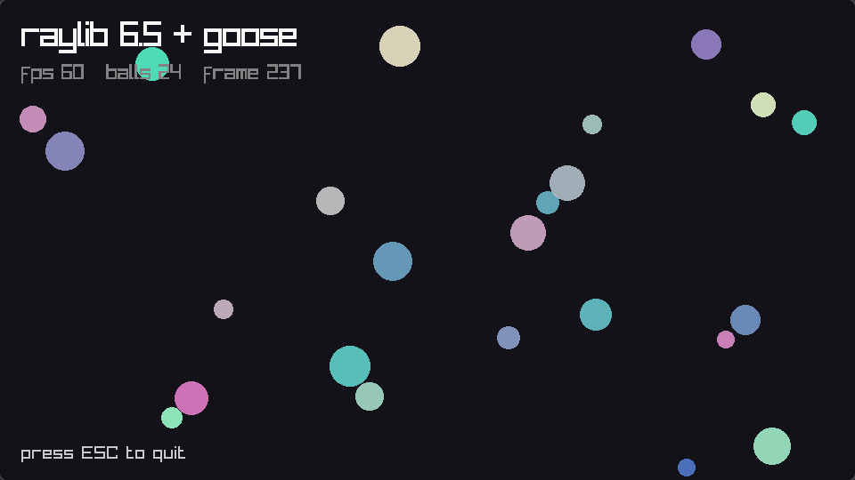

# raygoose

[](https://github.com/lamweilun/raygoose/actions/workflows/ci.yml)

A [raylib](https://github.com/raysan5/raylib) binding for the
[Goose](https://github.com/aardappel/goose) language, generated from raylib's
own headers.



Works today: **782 functions** from `raylib.h` and `rlgl.h`, **146 functions**
of `raymath` ported to Goose, **38 structs**, **~530 constants**, plus
string-taking overloads of the calls that need a C string. Goose calls raylib's
C functions directly — there is no marshalling layer at runtime, only the C
adapters listed below.

Pinned to raylib `8413b068` (v6.5-dev), built from the `vendor/raylib` submodule,
and tested with Goose `v2026.3-252-g2ed1a63d`.

## Platforms

Raylib itself is compiled from the submodule by the package's CMake target, so
its per-platform link dependencies (winmm/gdi32/opengl32 on Windows, the
Cocoa/IOKit/OpenGL frameworks on macOS, X11/GL on Linux) come along with the
target's link closure. Nothing platform-specific is written in the binding.

| target | what is verified |
|---|---|
| Linux x86-64 | built, all examples run |
| Windows x64, MSVC | CI: Goose built, binding generated, every example linked, headless smoke ran |
| macOS arm64 | CI: same |
| Windows x64 (MinGW ABI), Windows arm64 | `layout_check.c` and `shims.c` compile for the ABI |
| macOS x86-64, Linux arm64 | `layout_check.c` and `shims.c` compile for the ABI |
| 32-bit (x86, arm32, RPi 32-bit) | rejected at configure time, `sizeof(void*) != 8` |
| Web, Android, iOS | not supported: different toolchains and asset packaging |

The CI jobs build raylib from source and run `examples/smoke.goose` — headless,
so it works on a runner: raymath, a padded-struct return, the C `long` shim and
`ffi::cstr`. The windowed examples are built but not run there. `make
cross-check` covers the ABIs CI does not have a runner for: all 231 `sizeof` and
`offsetof` assertions and every adapter compile against the real headers for
LLP64 Windows and arm64 macOS/Linux.

C `long` is the one type whose width differs (8 bytes on LP64, 4 on Windows), so
it never crosses directly: `GetFileModTime` goes through a shim that widens to
`int64_t`, keeping one Goose signature everywhere — the smoke test reads it on
every platform. `raymath` is not bound at all: it is a Goose port, tested
against the C library on every build of the binding (`tools/check_raymath.py`).

## What is covered

Three headers, plus what they need to be usable:

| header | how | contents |
|---|---|---|
| `raylib.h` | `extern fn` | 619 functions — core/window, shapes, textures, text, models, audio, camera, gestures — 35 structs, 22 enums |
| `raymath.h` | Goose port, `namespace raymath` | 146 functions over the same `Vector2/3/4/Matrix/Quaternion` types |
| `rlgl.h` | `extern fn` | 163 functions, `rlVertexBuffer`/`rlDrawCall`/`rlRenderBatch`, 12 enums and the `RL_*` constants |
| types and constants | generated | 38 structs and ~530 constants (enums, `FLAG_*`, `RL_*`, the 26 color macros) |

Nine of the 38 structs contain C padding and cross by pointer through
`src/shims.c`; everything else crosses by value. `raymath` is not bound at all,
it is Goose code.

**Not covered yet:**

- `raygui` and `physac` — neither is part of raylib 6.5 (`raygui` ships as a
  header in the examples, `physac` is a separate, unmaintained repository).
- `rcamera`'s `GetCameraForward/Up/Right` — exported by the library but not
  declared in `raylib.h`; the two `UpdateCamera*` functions are covered.
- `rgestures`' internal `ProcessGestureEvent`/`UpdateGestures` — they take an
  internal event struct; the 8 public gesture functions are covered.
- The callbacks: `SetTraceLogCallback` (it takes a `va_list`), the four file
  callbacks and the audio processor callbacks. Goose has no function pointers.
- `TextFormat` — variadic; use Goose's `str(...)`.
- `rlLoadExtensions` — takes a function pointer.

Everything else in the raylib repository is examples, templates and resources.

## Using it

A program needs one import line; no build file of its own:

```goose
import raylib from "https://github.com/lamweilun/raygoose@main";

fn main() {
    raylib::InitWindow(800, 450, "hello");
    raylib::SetTargetFPS(60);
    while !raylib::WindowShouldClose() {
        raylib::BeginDrawing();
        raylib::ClearBackground(raylib::RAYWHITE);
        raylib::DrawText("hello from goose", 20, 20, 40, raylib::MAROON);
        raylib::DrawCircleV(raylib::Vector2 { 400.0, 300.0 }, 60.0, raylib::ORANGE);
        raylib::EndDrawing();
    }
    raylib::CloseWindow();
}
```

```sh
goose run app.goose     # first build compiles raylib, later runs are cached
```

## Getting the source

```sh
git clone --recurse-submodules https://github.com/lamweilun/raygoose
```

`vendor/raylib` is a submodule: clone with `--recurse-submodules`, or run
`git submodule update --init --recursive` afterwards. Then, inside the
repository:

```sh
make demo               # build and run examples/demo.goose
make gen                # regenerate raylib.goose, raymath.goose and src/*.c
make check              # build every example
```

Examples:

| file | what it covers |
|---|---|
| `examples/basic.goose` | raw API: window, shapes, text, FPS |
| `examples/demo.goose` | ergonomic layer, custom font, formatted text, 24 bouncing balls |
| `examples/hard_cases.goose` | raymath, rlgl, audio, render textures, ray casts, `ffi::cstr` |
| `examples/smoke.goose` | headless: raymath, a padded struct return, the C `long` shim, `ffi::cstr` |

## How the binding works

Goose compiles to one C file and its FFI is "declare the C function and call
it" (`docs/reference.md` §24). So a binding is mostly a transcription problem:

| C | Goose |
|---|---|
| `int`, `float`, `bool` | `i32`, `f32`, `bool` |
| `Color` by value | `struct Color { r: u8, g: u8, b: u8, a: u8 }` |
| `Texture2D` | `struct Texture` + alias resolved by the generator |
| `const char *` | `const u8&` (raw) or a slice helper (ergonomic) |
| `int *out` | `i32&` |
| `Font *` | `Font&` |
| `void *`, `char **`, library-owned pointers | `u64` |
| `#define LOG_INFO 4` | `let LOG_INFO: i32 = 4;` |

Goose structs are **packed**, so where C inserts padding the generator writes
`pad n` at the exact offset. `src/layout_check.c` asserts every `sizeof` and `offsetof` against the real
headers, so a wrong layout breaks the build instead of the drawing.

### The three things that need C

1. **Structs containing padding** cannot cross by value: `Sound`, `Music`,
   `AudioStream`, `Mesh`, `ModelSkeleton`, `Shader`, `RayCollision`,
   `FilePathList`, `rlVertexBuffer`. Each function that takes or returns one gets
   a shim (`PlaySound(Sound)` → `void rg_PlaySound(void *sound)`) or a thin
   Goose wrapper for returns (`LoadSound` → `Sound` through an out-pointer).
2. **Variadic functions** cannot be declared at all. `TraceLog` gets a fixed shim
   (`trace_log(level, text)`); `TextFormat` is deliberately not bound — use
   Goose's own `str(...)` and append `"\0"` for the C string.
3. **NULL pointers.** Goose references are never null, so functions that accept
   NULL (`LoadFontEx` with no codepoints, shader value pointers) go through
   shims. `src/shims.c` holds all of them; 89 of the 782 functions use one.

Everything else is a direct `extern fn` call — the same call the C compiler
would emit.

### raymath is ported, not bound

`raymath`'s 146 functions are translated to Goose in `raymath.goose`
(`namespace raymath`), not called through C. It is plain maths over the same
`Vector2/3/4/Matrix` types, so it inlines instead of crossing the boundary,
works with any raylib build, and `goose run` needs no C for it.
`tools/check_raymath.py` runs every function against the C original and
compares the results as C floats: the port is bit-identical on the current
header.

### Strings

raylib wants NUL-terminated `char *`. The raw declarations take `const u8&`, so
`DrawText("hi\0"[0], ...)` works. The helpers do it for you:

```goose
raylib::DrawText("hello", 20, 20, 40, raylib::RAYWHITE);
let t = str("fps ", raylib::GetFPS(), "\0");   // formatted, Goose's own str()
raylib::DrawText(t, 20, 60, 20, raylib::GRAY);
```

These are overloads under raylib's own names, so the raw form still works
where you want it (`DrawText("hi\0"[0], ...)`): `InitWindow`, `DrawText`,
`DrawTextEx`, `MeasureText`, `MeasureTextEx`, `LoadTexture`, `LoadImage`,
`LoadFont`, `LoadSound`, `LoadMusicStream`.

### Build

`raylib.build` names one CMake target. The root `CMakeLists.txt` builds the
vendored raylib plus `raygoose_native` (the shims and the layout asserts) and
links them statically into the program. That means:

- nothing needs to be installed on the machine;
- `goose run` works, since a native part is present;
- the library and the binding are versioned together.

A dynamic variant is also possible (`extern "raylib" { ... }` with a
`dylibs_linux` mapping), but it only covers the functions that need no shim, so
the generated binding uses the static path.

## Limitations

- **Callbacks are not bound.** Goose has no function pointers; `export fn` has a
  C symbol but no addressable value. `SetTraceLogCallback`, the four file
  callbacks and the audio processor callbacks are unreachable without a C
  trampoline per callback. Fixable, not done yet.
- **`TextFormat` is missing on purpose.** Use `str()`.
- **No pointer arithmetic.** `Mesh.vertices`, `Font.recs`, `Model.meshes`,
  `FilePathList.paths` and friends are opaque `u64` handles. You can pass them
  back to raylib, but to read elements you need `ffi::bytes(ptr, n)` (a copy) or
  a C accessor.
- **`u64` results cannot be dereferenced.** Strings come back via
  `ffi::cstr(GetWorkingDirectory())`.
- **`rlgl`'s extension loader** (`rlLoadExtensions`) takes a function pointer and
  is unusable.
- **64-bit only.** Pointers cross as `u64`, so 32-bit targets are refused at
  configure time.
- **Windows and macOS are tested headless only.** CI builds every example there
  and runs the smoke test; the windowed examples have only been watched on
  Linux x86-64.

## Regenerating

```sh
python3 tools/gen_bindings.py
```

```sh
python3 tools/gen_bindings.py   # raylib.h + rlgl.h -> raylib.goose, src/*.c
python3 tools/port_raymath.py   # raymath.h       -> raymath.goose
python3 tools/check_raymath.py  # port vs the C library, 146 functions
```

`gen_bindings.py` writes `raylib.goose`, `src/shims.c` and
`src/layout_check.c`; the ergonomic helpers are a fixed block at the end, so
they survive regeneration. `rlgl.h`'s implementation section is cut off.
`port_raymath.py` translates raymath's scalar bodies (its SSE branch is
dropped); three functions with out-parameters or a `switch` are hand-written
in it, and `check_raymath.py` builds both the C and the Goose versions, runs
them on the same inputs and compares the results as C floats.

Updating raylib: `git -C vendor/raylib checkout <tag> && make gen`, then
build the examples. The layout asserts catch struct changes; new variadic or
callback functions show up as skipped declarations in the generator log.

## Next steps worth doing

1. Callback trampolines: `export fn` hook + a C installer per callback
   (`SetTraceLogCallback` needs `va_list`, so a formatting trampoline).
2. Port `physac` (2D physics): bodies are heap pointers with public fields in C,
   so a port with a fixed pool of 64 bodies and index handles fits Goose better
   than wrapping it. Do not name the package `physics`: that name is blessed to
   `goose_physics` (3D Box3D).
3. Slice-based wrappers for the pointer+count pairs (`LoadFontData`,
   `TextSplit`, `DrawTriangleFan`, ...), which are the remaining ergonomic
   rough edge.
4. Split the generated file per module (core/shapes/textures/text/models/audio/
   rlgl) once Goose's multi-file package story matters for compile time.
5. Callback trampolines, so `SetTraceLogCallback` and the file callbacks can be
   installed from Goose through exported functions.
5. `raygui` and `physac` on the same generator; both are single-header C.

## AI disclosure

This project was written with an AI coding agent (OpenCode) working under a
human's direction: the header generator, the raymath port, the C adapters, the
examples and this document. The checks are not decorative — the struct layouts
are asserted against raylib's headers at compile time, the raymath port is
diffed function by function against the C library by `tools/check_raymath.py`,
and CI builds the binding and runs the headless smoke test on Linux, Windows and
macOS.
